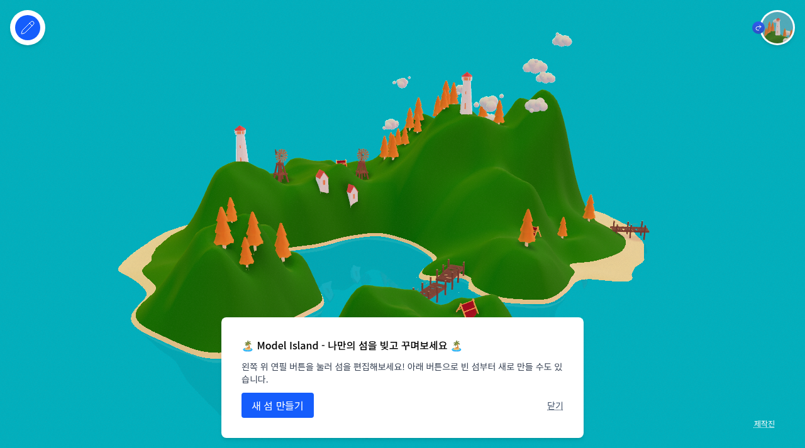

# 🏝️ MODEL ISLAND | 나만의 섬 만들기

[▶ 한국어판 실행](https://sigco3111.github.io/island/) · [원본 README](README.en.md)

승패 없이 지형과 장식을 만드는 3D 섬 제작 샌드박스입니다. 원작의 출처와 내부 식별자는 유지하고 사용자 화면을 한국어로 옮긴 포크입니다.

> **사용 전 확인:** 로컬 저장은 다른 기기에 자동 동기화되지 않습니다. 초기화하기 전에 JSON을 내려받으세요. 코드 MIT와 개별 모델의 자산 조건은 구분해야 합니다.

## 실행 화면



> 한국어 첫 방문 안내와 기본 예제 섬을 직접 캡처했습니다.

## 주요 특징

- 높이기·낮추기 브러시
- 집·등대·부두·나무 등 장식
- 브러시 크기·강도 조절
- 되돌리기와 JSON 스냅샷 보관

## 빠른 시작

1. 첫 안내 닫기
2. E로 편집 모드
3. 지형 드래그
4. 장식 배치
5. JSON 내려받기

## 기술 스택

React 19 · React Three Fiber · Drei · Three.js · Zustand · Zundo · Vite

## 문서 안내

- 아래에서 상세 조작, 한글화 범위, 개발·재배포 방법과 권리 고지를 확인하세요.
- `README.en.md`는 보존된 원본 설명입니다. 원작 기능과 이 포크의 검증 범위는 다를 수 있습니다.
- `korean-localization.patch`는 번역 변경 기록입니다.

---

마우스로 섬의 지형을 빚고 집·등대·나무·풍력 터빈 등으로 꾸미는 3D 샌드박스입니다. **Huw Roberts / wuhhh**의 원작을 한국어로 번역한 포크입니다.

## 시작하기

왼쪽 위 연필 버튼을 눌러 편집 모드를 켜세요. 왼쪽 도구 모음에서 지형 높이기와 낮추기를 선택하고 섬을 드래그합니다. 아래 장식 버튼에서 나무, 집, 등대, 부두, 텐트, 구름, 풍력 터빈을 골라 배치합니다.

## 조작과 도구

| 기능 | 단축키 |
|---|---|
| 편집 모드 전환 | E |
| 이동·카메라 도구 | V |
| 지형 높이기 / 낮추기 | A / S |
| 브러시 크기 | [ / ] |
| 브러시 강도 | - / + |
| 실행 취소 / 다시 실행 | U / Y |
| 초기화 | Shift + R |
| 도움말 | H |
| 장식 배치 | P |
| 선택 항목 삭제 | Backspace |

- 지형 편집 중 Alt를 누르면 높이기·낮추기를 임시 전환합니다.
- Ctrl을 누른 채 카메라를 조절할 수 있습니다.
- JSON 내려받기로 섬의 스냅샷을 저장합니다.
- 기본 섬 불러오기 버튼은 원작 예제 섬으로 돌아갑니다. 저장이 필요하면 먼저 JSON을 내려받으세요.
- 섬 상태는 브라우저의 로컬 저장소에 보존됩니다. 브라우저 데이터를 지우면 사라질 수 있습니다.

## 한글화 범위

도구 이름, 도움말·단축키, 첫 방문 안내, 장식 이름, 삭제, 초기화, 제작진과 기본 섬 불러오기를 번역했습니다. 내부 ID와 모델 이름, 원작자·자산 제작자 링크는 유지했습니다. 한국어 글꼴은 Noto Sans KR이며 시스템 글꼴 폴백을 제공합니다.

## 빌드와 배포

```bash
npm install
npm run dev
npm run build
```

Vite의 base는 `/island/`입니다. Pages는 `main`의 `/docs` 폴더를 게시합니다. `docs/index.html`은 `9-index.html`을 여는 launcher입니다. `docs/9-index.html`은 JS·CSS·모델·기본 스냅샷·아이콘을 포함한 한국어 정적 배포본으로 별도 서버가 필요하지 않습니다. 원본 소스와 `public` 자산도 포크에 보존합니다.

- `src/components/UserInterface.jsx`: 도구 구성
- `src/components/ui`: 도움말, 안내, 제작진, 편집 메뉴
- `src/hooks/useDecorRegistry.jsx`: 장식 모델과 표시 이름
- `src/styles.css`: 한국어 글꼴
- `README.en.md`: 원본 README
- `korean-localization.patch`: 원본과 한국어판 소스 변경 기록

## 원작과 자산 출처

원작 **Huw Roberts / wuhhh**: https://github.com/wuhhh/island

제작자 사이트: https://huwroberts.net

한글화·Pages 배포: **sigco3111** 포크.

코드 라이선스: **MIT**, 원본 `LICENSE` 파일을 보존했습니다. 3D 모델은 Kenney, Quaternius, Poly by Google 등 원본 제작진 화면의 개별 자산 출처 링크를 보존합니다. 아이콘은 Lucide입니다. 원작은 개발 중인 프로젝트이므로 편집 동작이나 지원 기기에 일부 제한이 있을 수 있습니다.
